# Preprocessing tutorial, CPSY 1197

This document walks you through preprocessing ERP CORE recordings, start to
finish, on your own machine. Everyone's first run is the same recording,
participant 1 of the P3b experiment. If your output looks like the blocks
shown here, you are on track. If it does not, the Troubleshooting section at
the end lists every error we ran into while testing, with the fix.

You will run the pipeline once per participant. Your homework is a set of
about ten participants, assigned individually, from one of three ERP CORE
experiments: the N170, the P3b or the N400. Section 7 introduces all three.

**Settings you do NOT change.** They are the same for everyone in the class,
so that your results can be compared with your classmates':

| Setting | Value | Why |
|---|---|---|
| Sampling rate after downsampling | 256 Hz | same as ERP CORE's own pipeline |
| Filter band | 0.1 to 30 Hz, on the continuous data | Recommendation for most common ERP components |
| Reference | average of P9 and P10; for the N170, the average of all good EEG channels | ERP CORE; section 7 says why the N170 differs |
| Event shift | +26 ms | the screen delay ERP CORE measured with a photosensor |
| Trials | stimuli with a correct answer in time: within 0.2 to 1.0 s, for the N400 within 1.5 s | ERP CORE's bin descriptor files, `BDF_P3.txt`, `BDF_N170.txt`, `BDF_N400.txt` |
| Epoch | -200 to +800 ms | ERP CORE|
| Baseline | -200 to 0 ms | ERP CORE |
| Automatic trial rule | a trial whose largest peak-to-peak swing in any EEG channel exceeds 125 µV (P3b) or 100 µV (N170, N400) is removed | the median of the limits ERP CORE chose per participant; section 6 |

**Decisions you DO make, and are graded on:**

1. Which channels are broken (stage 4).
2. Which ICA components are eye artifacts (stage 5).
3. Which of the remaining trials are bad (stage 9): you page through every
   trial and keep a list.

---

## 1. Setup check

You need a folder that contains the three pipeline files and your data:

```
your_folder/
  cpsy1197_preprocess.m
  cpsy1197_report.m
  cpsy1197_check.m
  data/
    1/1_P3.set
    1/1_P3.fdt
    12/12_N400.set
    12/12_N400.fdt
    ...one subfolder per assigned participant...
```

Copy both files of every participant, the `.set` and the `.fdt`. The `.set`
file is only the header; the voltages live in the `.fdt`. Participant 1 of
the P3b is the one everybody uses for the first run. Keep ERP CORE's file
names: the pipeline reads the experiment from them.

Open MATLAB, `cd` into your folder, and run:

```matlab
addpath('/path/to/fieldtrip-20260812')   % wherever you unzipped FieldTrip on 25 October
cpsy1197_check
```

(FieldTrip can also sit as a subfolder inside `your_folder`; give `addpath`
that subfolder.)

Expected output, after FieldTrip's welcome banner, here for a student with
ten N400 participants:

```
FieldTrip found: version 20260812
  at /Users/you/Documents/MATLAB/fieldtrip-20260812
Data found: 11 recording(s) in "data"
  P3b     1   participant 1
  N400   10   participants 11 12 13 14 15 16 17 18 19 20

READY. Start with the tutorial, section 2.
```

The list says which experiment each recording belongs to. Yours should show
participant 1 of the P3b, for the first run, and your own participants under
your own experiment. If one of yours shows up under another experiment, you
copied the wrong file.

If you see `MISSING` or `PROBLEM` instead, the message tells you what to fix.
Do not continue until it prints READY.

---

## 2. How FieldTrip works: cfg in, data out

Every FieldTrip function does one job, and you tell it how to do that job
through a **configuration structure**, which by convention is always called
`cfg`. A cfg is an ordinary MATLAB structure: a named collection of settings.
Here is the example of the low-pass filter:

```matlab
cfg = [];                     % start from an empty configuration
cfg.lpfilter   = 'yes';       % switch the low-pass filter on
cfg.lpfreq     = 30;          % its cutoff, in Hz
cfg.lpfilttype = 'firws';     % the kind of filter: a windowed-sinc FIR
dataCont = ft_preprocessing(cfg, dataCont);
```

**Data in, data out.** A FieldTrip function never changes your data in
place. It returns a new data structure, and the pipeline passes that on to
the next stage.

**Whatever you leave out takes its default.** `ft_preprocessing` has dozens
of options. Every option and its default is
listed in the function's help: type `help ft_preprocessing` in MATLAB. That
help text belongs to the FieldTrip version you installed, which is the one
that counts. The reference pages on
[fieldtriptoolbox.org](https://www.fieldtriptoolbox.org/reference/ft_preprocessing/)
describe the newest version and can differ in small ways.

**What a data structure contains.** After a run, `out.data` holds your
cleaned trials. Its most important fields:

| Field | What it holds |
|---|---|
| `label` | the channel names, one per row of every trial |
| `trial` | one matrix per trial, channels by time points; `out.data.trial{1}` is 33 by 257 |
| `time` | the time of each sample in seconds, -0.2 to 0.8 |
| `fsample` | the sampling rate, 256 |
| `trialinfo` | the event code of each trial, which is how the pipeline tells the conditions apart |
| `cfg` | the configuration of the last step, with every earlier step inside `cfg.previous` |

That last field is FieldTrip's record of everything that was done to the
data, back to reading the file. `ft_analysispipeline([], out.data)` draws it
as a flowchart. It is why a FieldTrip analysis can be reconstructed from its
output.


**`params` is your cfg.** Everything you hand to the pipeline goes into one
structure called `params`, and it behaves exactly like a cfg.

Each stage of the pipeline is one or two FieldTrip calls:

| Stage | FieldTrip function | The cfg fields that matter |
|---|---|---|
| 0 Look | `ft_read_header`, `ft_read_event` | none: they take the file name |
| 1 Low-pass | [`ft_preprocessing`](https://www.fieldtriptoolbox.org/reference/ft_preprocessing/) | `lpfilter`, `lpfreq`, `lpfilttype` |
| 2 Downsample | [`ft_resampledata`](https://www.fieldtriptoolbox.org/reference/ft_resampledata/) | `resamplefs` |
| 3 High-pass | `ft_preprocessing` | `hpfilter`, `hpfreq`, `hpfilttype` |
| 4 Bad channels | [`ft_databrowser`](https://www.fieldtriptoolbox.org/reference/ft_databrowser/), [`ft_selectdata`](https://www.fieldtriptoolbox.org/reference/utilities/ft_selectdata/) | `viewmode`, `blocksize`, `ylim`; `channel = {'all','-F8'}` |
| 5 ICA | [`ft_componentanalysis`](https://www.fieldtriptoolbox.org/reference/ft_componentanalysis/), `ft_topoplotIC`, `ft_rejectcomponent` | `method = 'runica'`, `randomseed`; `component` |
| 6 Reference | `ft_preprocessing` | `reref`, `refchannel`, `refmethod` |
| 7 Rebuild | [`ft_channelrepair`](https://www.fieldtriptoolbox.org/reference/ft_channelrepair/) | `method = 'spline'`, `missingchannel`, `elec` |
| 8 Epoch | [`ft_redefinetrial`](https://www.fieldtriptoolbox.org/reference/ft_redefinetrial/), `ft_preprocessing` | `trl`; `demean`, `baselinewindow` |
| 9 Reject | [`ft_rejectvisual`](https://www.fieldtriptoolbox.org/reference/ft_rejectvisual/) | `method = 'trial'`, `trials`, `ylim`, `keepchannel` |
| Averages | [`ft_timelockanalysis`](https://www.fieldtriptoolbox.org/reference/ft_timelockanalysis/) | `trials`, `channel` |

---

## 3. A first run

Work through this section once, on participant 1. Everyone in the class uses
the same participant for the first run, and the answers for its two decisions
are given below. Your own participants come later, and their numbers will
differ; the shape of the output should match.

### 3.1 Looking at the data

Run the pipeline on participant 1:

```matlab
out = cpsy1197_preprocess('data/1/1_P3.set');
```

Before it touches the data, it prints what is in the file:

```
=== CPSY 1197 preprocessing ===
data/1/1_P3.set

Channels 33   Sampling rate 1024 Hz   Duration 467.0 s
EEG (30): Fp1 F3 F7 FC3 C3 C5 P3 P7 P9 PO7 PO3 O1 Oz Pz CPz Fp2 Fz F4 F8
          FC4 FCz Cz C4 C6 P4 P8 P10 PO8 PO4 O2
Eye (3): HEOG_left HEOG_right VEOG_lower

Event types:
  trigger        n= 402  values: 11-15 21-25 31-35 41-45 51-55 201 202

Experiment: P3b, active visual oddball (from the file name; the event codes agree).
Trials, as ERP CORE defines them for this experiment:
  target           11 22 33 44 55
  standard         12-15 21 23-25 31 32 34 35 41-43 45 51-54
A stimulus counts as a trial only if a correct answer (201) follows
within 0.2 to 1 s.
```

Thirty-three channels: 30 EEG electrodes plus three eye channels (EOG) around
the eyes. The EEG names are printed exactly as you will type them at stage 4.
The eye channels record eye movement, not brain, and the pipeline treats them
accordingly: they help you find blinks and eye movements at stage 5, and they
are left out of every artifact computation.

The event codes need one minute of decoding. In the P3b task the participant
watched a stream of the letters A, B, C, D, E, and one letter per block was
the target. Each trigger has two digits: the first says which letter is the
target in this block, the second says which letter appeared. So `23` means
"B is the target, C appeared": a standard. `22` means "B is the target, B
appeared": a target. The codes where both digits match (11, 22, 33, 44, 55)
are targets, the other twenty are standards. Codes 201 and 202 are the
participant's answers, correct and incorrect; no trial is cut around them,
but they decide which letters count (section 3.2). You can check this scheme
against `P3_Event_Code_Scheme.xlsx` in the dataset
([osf.io/thsqg](https://osf.io/thsqg/)).

You did not have to tell the pipeline any of this. It read the experiment
from the file name, `1_P3.set`, checked that the codes in the file are the
P3b's, and printed how it groups them: the five target codes and the twenty
standard codes. Your own experiment may be a different one; section 7 shows
what the same lines look like for the N170 and the N400.

### 3.2 The trials

The last two lines of that block are ERP CORE's one rule about behaviour: a
letter counts as a trial only if the participant answered it correctly, and
in time. The next event after the letter must be a 201, between 0.2 and 1.0 s
after the letter appeared. On a letter with a wrong answer, or none, we
cannot tell whether the participant saw it the way the task intended. The
rule comes from ERP CORE's bin descriptor file for this experiment,
`BDF_P3.txt`, and stage 8 tells you how many letters it left out.

The run then continues on its own. The computation takes about ten seconds
on a recent laptop and perhaps a minute on an older one. Everything else is
the time you spend looking, which is the point.

### 3.3 Stages 1 to 3: filtering and downsampling (no input needed)

FieldTrip prints a few lines of its own for every step. The ones that matter:

```
--- 1. Low-pass filter ---
Lowpass filtering data: onepass-zerophase, order 452, hamming-windowed sinc FIR
  cutoff (-6 dB) 30 Hz
Low-pass filtered at 30 Hz.

--- 2. Downsample ---
Resampled 1024 -> 256 Hz.

--- 3. High-pass filter ---
Highpass filtering data: onepass-zerophase, order 4224, hamming-windowed sinc FIR
  cutoff (-6 dB) 0.1 Hz
High-pass filtered at 0.1 Hz.
```

Why these three, in this order. The low pass at 30 Hz removes the
high-frequency noise we never analyse. The downsampling exists for speed: 1024
Hz is far more temporal detail than an ERP needs, and everything after it
runs four times faster at 256 Hz. The high pass at 0.1 Hz removes the slow drift that would otherwise swamp the
baseline. A filter this slow reaches across many seconds of data, which is
why it runs on the continuous recording and not on short trials.

This is what the filtering buys you, on channel Pz of participant 1:

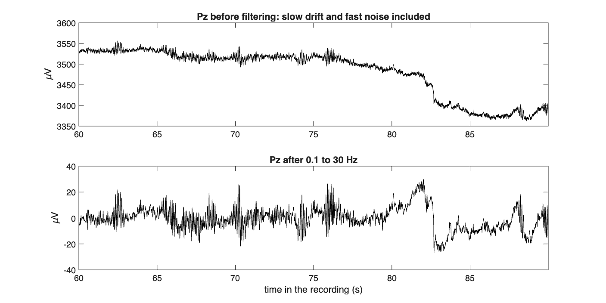

The slow sway in the top panel is skin potential and amplifier drift, not
brain. After the filters the trace sits around zero, and the ERP has a stable
baseline to be measured against.

### 3.4 Stage 4, bad channels: your first decision

```
--- 4. Bad channels ---
Opening the browser: 30 s per page, every channel on the same
+/-100 uV scale, the eye channels at the bottom. Page through the
whole recording, then close the window to continue.
```

A window opens with the whole recording, 30 seconds per page, one channel per
row. FieldTrip prints the keyboard shortcuts in the command window: the arrow
buttons below the traces, or the right and left arrow keys, move one page.
Page through the whole recording; it is about 16 pages. Section 4 below shows
you what to look for. When you close the window (or press `q`), the command
window asks:

```
Broken channels, comma separated (Enter for none): F8
Marked broken: F8. Removed now, rebuilt at stage 7.
```

For participant 1, type `F8`. Case does not matter (`f8` works too), and if
you type a name that is not a channel, the prompt tells you so and asks
again.

The channel you name is taken out of the data immediately, so that it plays
no part in the ICA or in the reference, and it is rebuilt from its neighbours
at stage 7.

### 3.5 Stage 5, blinks and eye movements: your second decision

The pipeline runs ICA on the 29 remaining EEG channels. You will watch about
75 lines like `step 42 - lrate ...` scroll by; that is normal and takes a few
seconds. Then:

```
Correlation of each component with the eye channels:
comp     r(VEOG)   r(HEOG)
1          -0.70     -0.48
8           0.41      0.00
4          -0.36      0.01
6           0.32     -0.04
12         -0.14     -0.25
22         -0.02      0.22
11          0.15     -0.21
7          -0.20     -0.03
A blink component has |r(VEOG)| far above the rest, a frontal
topography, and a time course of isolated spikes. An eye-movement
component has a high |r(HEOG)|, a map positive on one side of the
forehead and negative on the other, and a time course of steps.
All three signs, not one of the three.

Opening the component browser. Check topography AND time course,
then close the browser to continue.
```

Two windows open: a grid of component topographies, and a browser with each
component's time course. Section 5 explains how to read them. When you close
the browser, it asks:

```
Components to remove, comma separated (Enter for none): 1
Removed component(s) 1.
```

For participant 1 the answer is `1`, and section 5 shows why.

### 3.6 Stages 6 to 8 (no input needed)

```
--- 6. Re-referencing ---
Referenced to P9 + P10.

--- 7. Rebuilding removed channels ---
Rebuilt from their neighbours: F8

--- 8. Epoching and baseline ---
195 trials, -0.2 to 0.8 s, baseline -0.2 to 0 s, events shifted +26 ms.
  target 35   standard 160
  5 of 200 stimuli are not trials: no correct answer within 0.2 to 1 s.
```

The reference is the average of P9 and P10, Luck's preference for the ERP
CORE experiments (the N170 has its own, section 7). It is built from good
channels only; that is why broken channels leave the data at stage 4.

F8 is then rebuilt by spherical spline interpolation (Perrin and colleagues,
1989), the method ERP CORE used for these recordings. The recordings contain
no electrode positions of their own ("the channel positions are in general
not recorded during EEG measurements",
[FieldTrip](https://www.fieldtriptoolbox.org/workshop/madrid2019/tutorial_erp/)),
so the positions come from FieldTrip's standard 10-20 template. You will see
FieldTrip mention "missing channels" and "spherical fit": that is this step.

Then the recording is cut into one-second trials, one per letter that was
answered correctly in time: 195 of the 200. The five letters left out were
all targets, which is where most mistakes happen in this task. Each event code
marks the moment the computer sent a letter to the screen, and the screen
showed it 26 ms later. The ERP CORE lab measured that delay with a
photosensor and shifts every stimulus code by it (ERP CORE `README_P3.txt`,
Script 1), so the pipeline does the same. Without the shift, every latency
you measure would be 26 ms too late.

### 3.7 Stage 9, rejection: your third decision

Stage 9 works in two steps. First, a rule that is the same for everyone
removes the trials that are obviously ruined. Then you look at every trial
that is left, one by one, and mark the ones that are bad. That list of
trials is your third decision. Section 6 explains the rule, how to look, and
what to mark.

```
--- 9. Rejecting bad trials ---
Peak-to-peak per trial (uV): median 81, 90% 111, 95% 117, largest 356
The rule removes the 7 of 195 trials that swing more than 125 uV:
  14 25 91 92 93 95 187

                     without ICA    with ICA
   trials removed      16 ( 8%)        7 ( 4%)
   recovered                        9 trials
```

The rule is automatic: any trial in which some EEG channel swings by more
than 125 µV (the P3b value) from its lowest to its highest point is removed
before you see it. You do not choose the number.

The second block is the pipeline's answer to a question you should be asking:
did the ICA at stage 5 help? The pipeline kept a copy of the data without
your component removal, pushed it through the identical remaining stages, and
applied the identical rule. For participant 1, nine trials that would have
been lost to eye artifacts survived because the blink was subtracted
instead. That block comes from a single run; you never run the pipeline twice
for it.

Then the trial window opens, with the instructions printed above it:

```
Now look at the rest. One trial per screen, all channels, same scale.
  Next, previous trial : right and left arrow keys
  Mark trial as bad    : b   (the trial goes blank)
  Take the mark back   : g
  Finish               : q, or the quit button
A trial that is blank when you arrive was removed by the rule; g does not
bring it back. Do not click on a trace, that only hides the trace. Closing
the window with the mouse instead of q keeps every trial and forgets your
marks.
```

FieldTrip then prints a few lines about the window (how many trials start as
included, and so on); they need no action. This is `ft_rejectvisual` in
`trial` mode. It shows one trial at a time, every EEG channel in its own small
box, all boxes on the same scale. The scale is fixed so that a channel that
swings as much as the rule allows (125 µV) just fills its box. Make sure the
window is the active one (click on its title bar, not on a trace), then press the right arrow
to move through the trials. The number in the title is the trial's number in
the epoched data, the same number the report lists at the end.

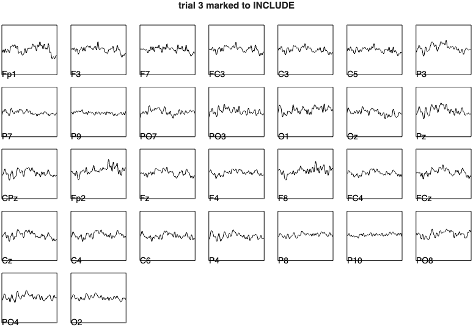

Trial 3 above is what a good trial looks like: every channel wanders around
the middle of its box. Trial 46 below is one to mark: Fp1 drifts out of its
box, and F8, O1 and PO8 wander far more than their neighbours, while the
other channels stay calm. It passed the rule, with a largest swing of 103 µV,
and it is still not usable.

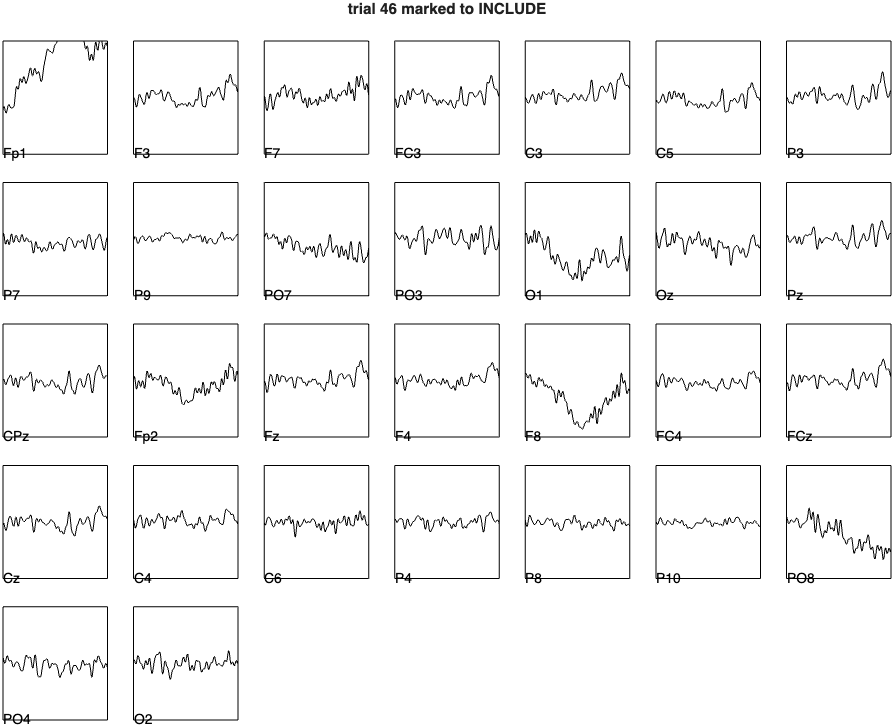

Press **b** and the trial goes blank and its title says it is marked to
EXCLUDE. A trial that is already blank when you arrive was removed by the
rule:

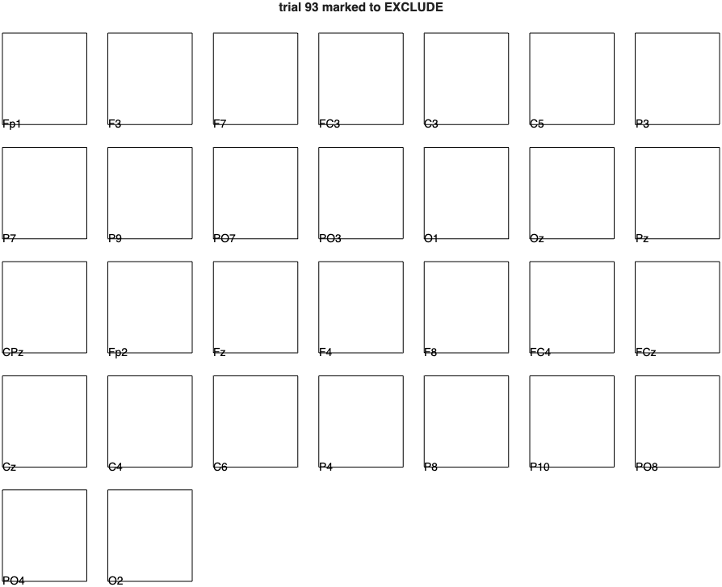

When you have been through all trials, press **q**. The console then lists
what you marked, and the totals:

```
the following trials were removed: 13, 14, 25, 46, 48, 91, 92, 93, 95, 133, 187

By hand you removed 4 trials:
  13 46 48 133

Kept 184 of 195 trials (5.6% rejected: 7 by the rule, 4 by hand).
```

The line from FieldTrip lists the rule's trials and yours together; the line
below it is yours alone. Your own marks will be different from these four:
they depend on what you see, and that is the point. Channels cannot be
removed in this window, they were decided at stage 4.

### 3.8 The output

```
--- Averages and summary file ---
  target            34 trials averaged
  standard         150 trials averaged
Saved data/1/1_P3_summary.mat (60 kB).
Saved data/1/1_P3_clean.mat (10.7 MB). Keep it on your machine, do not upload it.

Done. Now print your report:
  cpsy1197_report(out, 'Your Name')
```

The pipeline wrote a small summary file next to the raw data. It contains
your full decision log and the average waveform of each condition, and it is
the file you upload to Canvas. It is deliberately small: about 60 kB, or
120 kB for the N170, which has four conditions, so ten of them come to about
a megabyte. Your full cleaned data is saved next to it as
`data/1/1_P3_clean.mat`. Keep that file on your machine, you need it in
November. Then print your submission block:

```matlab
cpsy1197_report(out, 'Your Name');                  % prints your submission block
```

And this is why we do any of it. After the whole pipeline, targets against
standards at Pz, participant 1:

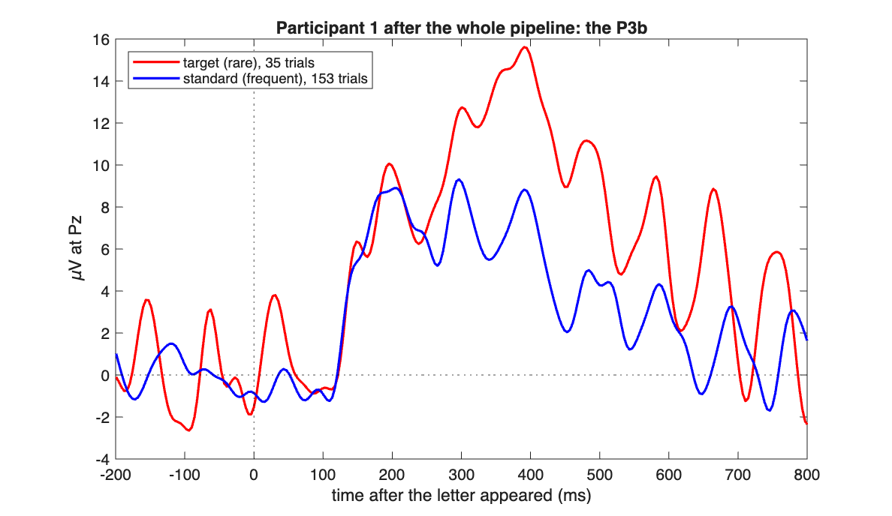

A rare target produces the large positive wave peaking around 400 ms after
the letter appeared. That is the P3b. It was in the raw data all along,
buried under drift, blinks and noise.

---

## 4. Decision one: bad channels

A broken channel is an electrode that did not record brain. The usual causes
are an electrode that lost contact, dried gel, or a broken wire. You find
them **by looking**, the way FieldTrip's own EEG tutorials do it: page through
the recording, then type the names
([FieldTrip, Madrid 2019](https://www.fieldtriptoolbox.org/workshop/madrid2019/tutorial_cleaning/)).
The examples below come from P3b recordings. The three experiments were
recorded with the same cap and the same 30 channels, so a broken channel
looks the same in all of them.


**Why the order matters.** A broken channel is taken out of the data at
stage 4, before the ICA and before the reference, and rebuilt from its
neighbours at stage 7. If it stayed in, it would make components of its own
in the ICA, and with an average reference its noise would be averaged into
every other channel: "by subtracting an average, noisy periods present in
only few EEG channels will spread to all other channels"
([FieldTrip](https://www.fieldtriptoolbox.org/workshop/madrid2019/tutorial_cleaning/)).
FieldTrip's ICA tutorial gives the same order: remove bad channels before the
decomposition, repair them after it
([FieldTrip ICA tutorial](https://www.fieldtriptoolbox.org/tutorial/preproc/ica_artifact_cleaning/)).

### What a broken channel looks like

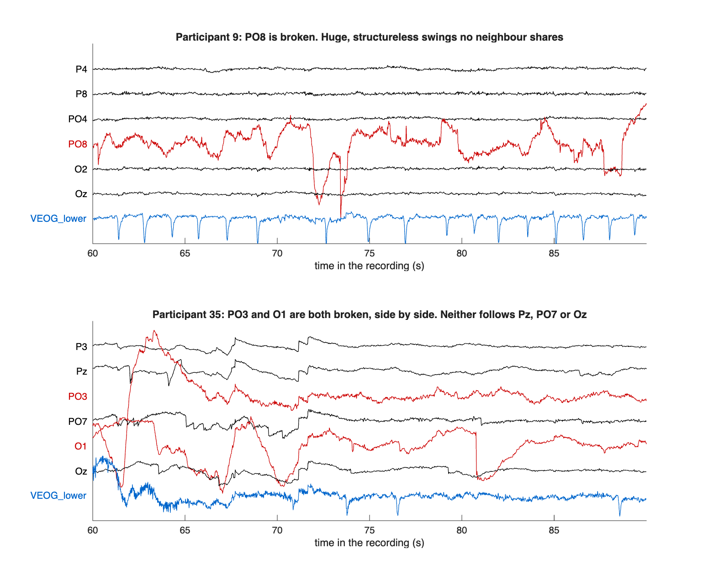

These two panels look the way the browser shows them: 30 seconds, each
channel in its own band, all on the same scale. In the top panel, PO8 of
participant 9 swings by hundreds of microvolts, steps up and down, and runs
through its neighbours' bands, while P4, P8, PO4 and O2, a few centimetres
away, stay calm. Nothing it does is shared by any neighbour. In the bottom
panel, participant 35 has two broken channels side by side, PO3 and O1;
neither follows Pz, PO7 or Oz. Note the small steps that P3, Pz, PO7 and Oz
all take at the same moments: those are shared, so they are not a channel
fault.

A **flat** channel is broken too: a straight line in a band where every
other channel wiggles. It is the easiest fault to see in the browser.

### What a healthy channel with blinks looks like

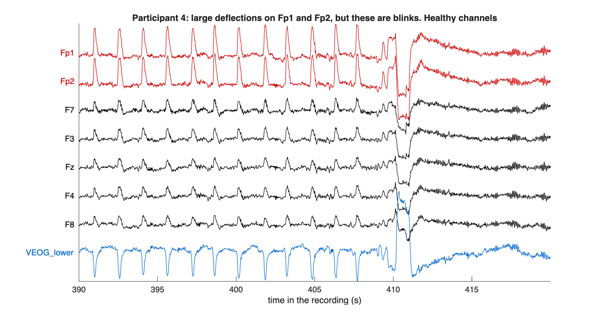

Participant 4, the frontal channels with the vertical eye channel at the
bottom. Fp1 and Fp2 show large deflections every second or two. They are
blinks: the same shape every time, on both channels at once, weaker on F3,
Fz and F4 further back, and mirrored in VEOG_lower below the eye. The
electrodes are doing their job perfectly. Naming
them as broken would throw away healthy channels, and the blinks would still
be in every other frontal channel. Blinks are handled at stage 5, not here.
(The big swing at 410 s, on every channel at once and in the eye channel,
comes from the eyes too: shared, so not a channel fault.)

### A channel that is broken for a stretch

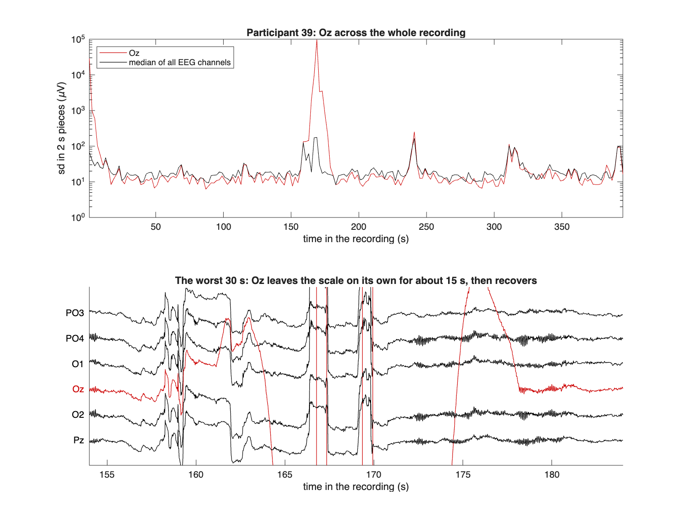

Participant 39. For most of the recording Oz moves like every other channel
(the top panel follows its size across the whole session). Around 165 s it
leaves the scale on its own for about fifteen seconds, then recovers. Is it
broken? The ERP CORE authors kept it, presumably because the damage is
confined to one stretch, and the trials in that stretch are rejected at stage
9 anyway. Removing it is also defensible. What matters is that you saw it,
looked at how long it lasted, and wrote down what you decided and why.

### What to check before you name a channel

- Is it wrong **in a way its neighbours are not**? Anything every channel does
  at the same moment (drift, a movement, an eye movement) is not a channel
  fault.
- Is it wrong **for most of the recording**, or only for a stretch? A long
  failure is a broken channel; a short one is a judgement call, and stage 9
  takes care of the trials inside it.
- Are the big deflections **stereotyped and shared** (blinks, stage 5
  material), or **structureless and on their own** (a broken channel)?

Expect none or one broken channel in most recordings, occasionally two. In
the 40 P3b recordings the ERP CORE authors interpolated no channel in 28, one
in 6, two in 5, and three in one; the N170 and N400 recordings look the same
(no channel in 25 and in 28 of 40), with a single N170 recording at five. If
you find yourself naming four, stop and look again.

### What happens if your reference channels are bad?

In the P3b and the N400, P9 and P10 are the reference. If you name P9 or
P10, the reference changes, and the pipeline says so in capitals:

```
REFERENCE CHANGES. P9 is one of the reference channels and you marked
it broken, so at stage 6 the reference becomes P10 ALONE instead of
the average of P9 and P10. Your data will then differ from your
classmates'. Say so in your log.
```

P9 and P10 sit at the very edge of the cap, so they cannot be rebuilt well
from their neighbours; that is why the other one carries the reference alone
instead. ERP CORE's lists of interpolated channels cannot tell you how often
P9 or P10 is bad: as the reference, they were never candidates for
interpolation. So look at them as closely as at any other channel, and twice
before you name one. If you name both, the run stops and asks you to look
again.

In the N170 the reference is the average of all good EEG channels (section
7), so P9 and P10 are ordinary channels there. If one of them is broken,
name it like any other; the pipeline removes it and rebuilds it, and the
reference stays the average.

---

## 5. Decision two: ICA components

ICA splits your EEG channels into as many components, each with a fixed
scalp map and its own time course. If you subtract a
component, i.e. the eye blink component, then the blink is gone from every channel, while the trial survives.
That is the whole trick, and it is the standard approach from the
[FieldTrip ICA tutorial](https://www.fieldtriptoolbox.org/tutorial/preproc/ica_artifact_cleaning/).

The pipeline gives you three pieces of evidence per component. All three should agree before you remove anything.

**1. The correlation table.** The eye channels sit next to the eyes and
record every blink directly. The pipeline builds them the way ERP CORE does:
vertical as the electrode below the eye minus Fp2 above it, horizontal as
left minus right. A component whose time course correlates strongly with the
vertical one follows the blinks; one that correlates strongly with the
horizontal one follows sideways eye movements (see below). The correlation skips the first and last ten
seconds of the recording, because the high-pass filter rings at the edges and
that one transient could hand a meaningless component a large r. For
participant 1, component 1 stands far above the rest, at -0.70. The sign
does not matter; the size does.

**2. The topography.** A blink component is strongest at the front of the
head, at Fp1 and Fp2, fading quickly backwards:

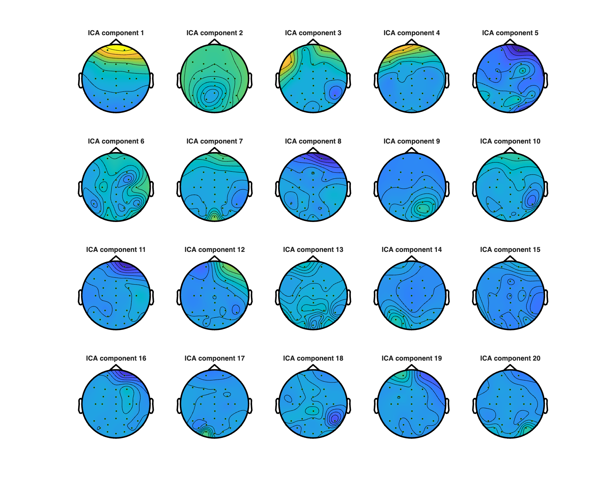

**3. The time course.** Isolated spikes that line up with the vertical eye
channel, one for one:

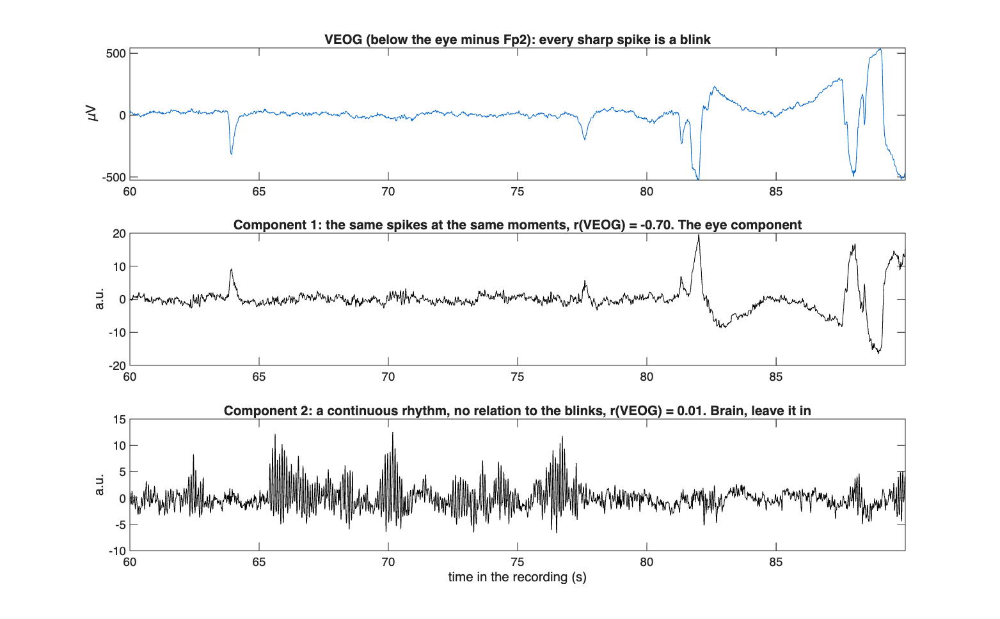

Top: the vertical eye channel, every sharp spike a blink. Middle: component
1, the same spikes at the same moments. Bottom: component 2 for contrast, a
continuous rhythm (alpha, about ten cycles per second) with no relation to
the blinks. That is brain, and it stays in.

For participant 1 all three lines of evidence point at component 1, so it
goes. Here is Fp1 before and after:

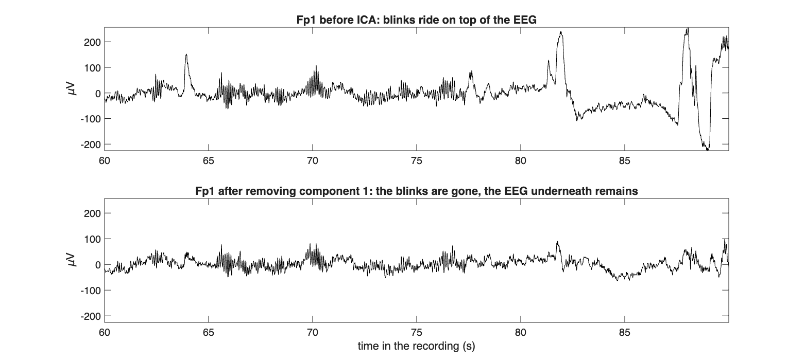

The blinks are gone and the EEG underneath remains. Note what did **not**
happen: the trace did not flatten. If removing your components visibly damps
the whole signal, you removed too much.

**What about component 4?** Its map is frontal too, and it correlates -0.36
with the vertical eye channel, the third highest. But its time course shows
a step at 73 s that the eye channel does not show, so it is not only an eye
component, and removing it does not help at stage 9: with components 1 and 4
removed, 9 trials fail the rule, against 7 with component 1 alone. By
the rule below, it stays in.

**Eye movements.** Blinks are not the only eye artifact. When the eyes turn
sideways, the horizontal eye channel steps up or down and stays there until
they turn back, and ICA often collects these movements into a component of
their own; you will meet one in many N170 and N400 recordings. The three
pieces of evidence still apply, adapted: a high correlation with the
**horizontal** eye channel, a map that is positive on one side of the
forehead and negative on the other (the eyes carry an electric charge, front
positive and back negative, so turning them shifts the voltage from one side
to the other), and a time course of steps rather than spikes. Here is one,
from a P3b recording that nobody in the class has been assigned:

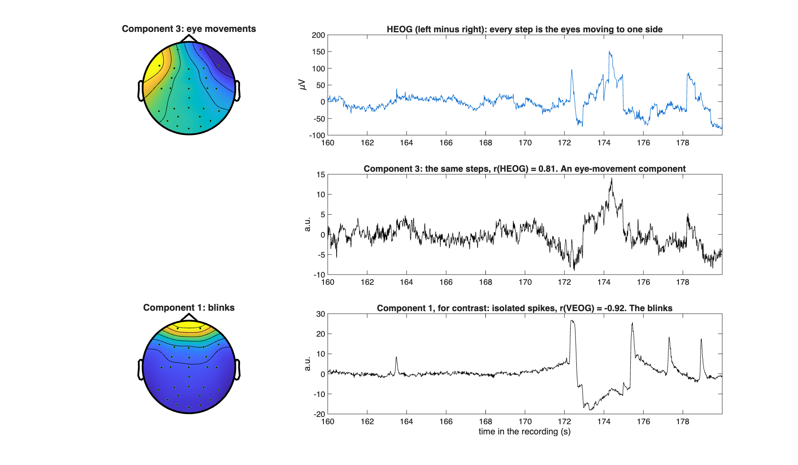

Component 3 follows the horizontal eye channel step for step (r = 0.81), and
its map runs from one side of the forehead to the other. Component 1 below
is the same recording's blink component, for contrast: a frontal map and
isolated spikes. Both are artifacts you can name, so both go, and a blink
component plus an eye-movement component is still "usually one or two".

**How many to remove: usually one or two, sometimes three, rarely more.** In
the 40 P3b recordings the ERP CORE authors removed one component in 24, two
in 11 and three in 5. In the N170 and the N400 they removed more, because
those recordings also carry horizontal eye movements: three or four
components in 13 of the 40 N170 recordings, and in 13 of the 40 N400
recordings. This is worth being blunt about. Every component you
remove takes some real signal with it, because the separation is never
perfect. Removing too little is a visible, recoverable problem: leftover eye
activity is caught at stage 9 and costs you a few trials. Removing too much
is invisible and permanent: the data look clean because something that
belonged there is gone, and no later stage can tell you. So the rule for
this course: **if you cannot name what artifact a component is, leave it
in.** Stage 9 is the safety net for whatever remains.

**The table is a hint, not a verdict.** In one of the P3b recordings, the
largest component has a frontal map but correlates only -0.33 with the eye
channel, and leaving it in costs more than half of the trials at stage 9.
Its map and time course give it away. If your rejection count stays high
after removing the obvious blink component, look again at the large frontal
components, not only at the top of the table.

**When ICA makes it worse.** Check the comparison block at stage 9: removing
eye components should lower the number of rejected trials. Once in a while it
raises it. When we ran the pipeline on all 40 recordings of each experiment,
with the components picked automatically by their correlation, that happened
in 3 of the 40 N400 recordings and 2 of the 40 N170 recordings, and in none of
the P3b. On N400 participant 29, a component that correlates 0.82 with the
horizontal eye channel looks like an eye-movement component in the table,
yet removing it cost every one of the 117 trials; removing only the blink
component instead lowered the loss from 44% without ICA to 15%. Part of the
reason is that the ICA here learns from the whole recording, including the
breaks between blocks, where people move and talk; ERP CORE cuts the breaks
out before its ICA. So if your "with ICA" count is higher than your "without
ICA" count, run that participant again and remove only the component whose
three signs are clearest, usually the blink. If even that makes it worse,
remove nothing, and say so in your log.


---

## 6. Decision three: which trials are bad

Stage 9 has two steps, and only the second one is yours.

**Step one, the rule (automatic).** After epoching, every trial is tested
against one fixed number: the largest **peak-to-peak** swing (maximum minus
minimum) of any EEG channel within the trial. A trial that swings more than
the limit is removed before you see it. It catches the obvious cases: a
movement, an electrode pop, an eye movement the blink component did not
cover, a burst of muscle.

This is the test the ERP CORE authors used for these recordings: peak to
peak within the epoch, with a limit chosen for each participant
(`AR_Parameters_for_MW_CRAP_*.xlsx` in the ERP CORE files). The pipeline uses
the median of their choices for your experiment, the same limit for every
participant and every student:

| | P3b | N170 | N400 |
|---|---|---|---|
| ERP CORE's limits, median (range) | 125 µV (65 to 180) | 100 µV (85 to 175) | 100 µV (70 to 160) |
| The pipeline's fixed limit | 125 µV | 100 µV | 100 µV |
| With ICA, the median participant loses | 2% | 2% | 4% |
| Without ICA | 49% | 58% | 54% |

The last two rows come from running the pipeline on all 40 recordings of
each experiment, with ERP CORE's bad channels, over the participants ERP
CORE kept. ERP CORE measured the swing in a window that moves through the
epoch, for many participants half the epoch long; the pipeline always takes
the whole epoch, so its numbers are close to theirs but not identical. In
FieldTrip the same test is `ft_artifact_threshold` with
`cfg.artfctdef.threshold.range`; we checked on one recording of each
experiment that it flags the same trials.

The limit is fixed rather than yours for a reason. A number that each of you
tuned for each participant would make your results incomparable, and tuning
it after looking at the averages is a way to manufacture an effect. A
peak-to-peak rule is also blind to some of what makes a trial bad, which is
why step two exists.

**Reading the console.** The first lines of stage 9 describe the rule's
work:

```
Peak-to-peak per trial (uV): median 81, 90% 111, 95% 117, largest 356
The rule removes the 7 of 195 trials that swing more than 125 uV:
  14 25 91 92 93 95 187
```

For participant 1 half the trials swing less than 81 µV and 95 percent less
than 117 µV, and a handful sit far out to the right. Here is the whole
distribution, without and with ICA:

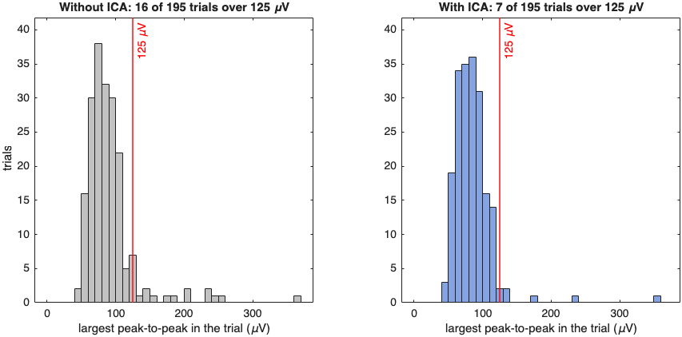

Most trials form a compact cluster, and a thin tail runs out to the right.
The rule cuts off the tail. The left panel is the same participant without
the ICA correction: the tail is longer, because the blinks are still in.

**Step two, your look at every remaining trial.** What the rule cannot see
is a trial that is wrong but swings less than the limit. Look at trial 46 in
section 3.7: it stayed under 125 µV, but one channel drifts away while its
neighbours stay calm. Only a person paging through the trials notices that,
and you go through every trial once, in order, and keep a list of the ones
you mark. The list is your third decision, and it is graded the way the
other two are: on whether you looked, and on whether you can say why each
trial is on it.

**How to look.** A recommendation, from how this is done in practice:

1. **Go through all of them, in order, once.** Do not skip around and do not
   start with the trials that look suspicious from the first glance at the
   console. The same attention for trial 5 and trial 150 is what keeps the
   list consistent.
2. **Look at the box, not at the single trace.** Each channel has its own
   small box, and the box is as tall as the rule's limit. A healthy trial is
   a mass of traces wandering around the middle of their boxes. Look for the
   channel that does something the others do not.
3. **Mark a trial for what you can name.** The usual reasons:
   - a channel that drifts off slowly while the others stay calm (trial 46);
   - a jump, a sudden step in one or several channels;
   - a burst of fast, ragged activity on a few channels, the usual look of
     muscle;
   - a flat channel, or one that leaves its box and comes back;
   - a blink that the ICA left behind, a large smooth deflection on Fp1 and
     Fp2 that spills out of its box.
4. **Do not mark a trial for being busy.** Oscillations that appear on
   every channel at once, as alpha does, are brain activity, not an
   artifact. A trial that looks messier than the one before is not
   necessarily bad.
5. **If you hesitate, leave it in.** An average of about 150 trials is
   robust to a mildly noisy one. Removing trials on a feeling is how bias
   enters, and a list of clear cases is easy to defend.
6. **Take marks back with g.** If, a few trials later, you decide an earlier
   mark was wrong, you can go back with the left arrow and press **g**.

For participant 1 this produced four marks: 13, 46, 48 and 133. Each is a
trial under 125 µV in which one channel drifts by 80 to 100 µV. Your marks
for the same participant may differ a little from ours, and that is fine: the
log says what you marked.

The window shows no condition. You do not know whether trial 133 is a target
or a standard, and you should not look it up. **Decide before you have seen
the averages, and do it once.** Rejecting harder in one condition than in
another manufactures a difference between them that no statistic will catch,
and hand-picking trials after seeing the results is how bias enters an ERP
analysis. The written list, which the report prints with the trial numbers,
is your protection.

**The report lists every removed trial**, by the rule and by hand, with the
number each had in the epoched data (section 9). Your list in the log is
what your classmates, and we, compare.

**Running it again.** If you have to re-run a participant, for instance
because you wanted to change a stage 4 or 5 decision, you do not have to
page through all trials again. Run the pipeline with your decisions filled
in, the list of marked trials, and the windows switched off. It takes a few
seconds:

```matlab
params.badChannels  = {'F8'};        % your stage 4 answer
params.removeComps  = 1;             % your stage 5 answer
params.badTrials    = [13 46 48 133];  % your list from the trial window
params.interactive  = false;         % no windows, no questions
out = cpsy1197_preprocess('data/1/1_P3.set', params);
```

The trial numbers stay the same when you change a stage 4 or 5 decision,
because they come from the events, but a different decision can change
which trials the rule removes; a trial you marked may then be gone
already, and the report lists it under the rule. The final run for your report should be the
real one, with the trial window.

Two sanity bounds, both of which the report flags:

- **Under 1% rejected.** Some participants are this clean after ICA; say so
  in your log, and check that you looked.
- **Over 25% rejected.** Something is wrong, or this participant is
  genuinely noisy. Find out which before you go on. Check for a missed broken
  channel, check your components, and see which of the trials the rule took
  and which you did. The ERP CORE authors excluded some participants from
  their own analysis: six of the 40 in the P3b, three in the N170 and one in
  the N400, most of them for losing more than a quarter of their trials or
  for keeping too few in one condition. One of yours may be among them, and
  then the honest answer is a sentence in your log, not a rule that has been
  loosened to keep garbage.

---

## 7. Your own experiment

Your own participants come from one of three ERP CORE experiments. The
pipeline is the same for all three, and so are your three decisions. It
reads the experiment from the file name (`12_N400.set` is the N400), checks
it against the event codes inside, and prints both at the top of the run.
What the experiment changes is which events become trials, how they group
into conditions, the limit of the automatic trial rule, and, for the N170
only, the reference.

| | P3b | N170 | N400 |
|---|---|---|---|
| What the participant saw | the letters A to E, one of them the target in each block | a face, a car, or a scrambled version of either | a red prime word, then a green target word |
| What they answered | target or not | "object" (face or car) or "texture" (scrambled) | related to the prime or not |
| Trials and their codes | target 11 22 33 44 55; standard the other twenty | faces 1-40, cars 41-80, scrambled faces 101-140, scrambled cars 141-180 | the target word: unrelated 221 222, related 211 212 |
| Correct answer within | 0.2 to 1.0 s | 0.2 to 1.0 s | 0.2 to 1.5 s |
| Reference | P9 + P10 | average of all good EEG channels | P9 + P10 |
| Where ERP CORE measures it | Pz, 300 to 600 ms, target minus standard | PO8, 110 to 150 ms, faces minus cars | CPz, 300 to 500 ms, unrelated minus related |
| Trial rule, peak-to-peak limit | 125 µV | 100 µV | 100 µV |
| Length of a recording | 5.5 to 9 minutes | 8.5 to 14 minutes | 6.5 to 11 minutes |

The tasks are described in Kappenman and colleagues (2021), section 2.2;
the codes and the answer windows come from ERP CORE's bin descriptor files.

**What the top of your run looks like.** For N170 participant 1:

```
Event types:
  trigger        n= 640  values: 1-80 101-180 201 202

Experiment: N170, face perception (from the file name; the event codes agree).
Trials, as ERP CORE defines them for this experiment:
  faces            1-40
  cars             41-80
  scrambled faces  101-140
  scrambled cars   141-180
A stimulus counts as a trial only if a correct answer (201) follows
within 0.2 to 1 s.
```

and for N400 participant 1:

```
Event types:
  trigger        n= 362  values: 111 112 121 122 201 202 211 212 221 222

Experiment: N400, word pair judgement (from the file name; the event codes agree).
Trials, as ERP CORE defines them for this experiment:
  unrelated        221 222
  related          211 212
Not trials: 111 112 121 122, the prime words, which come first in each pair.
A stimulus counts as a trial only if a correct answer (201) follows
within 0.2 to 1.5 s.
```

In the N400, each trial is a target word. The prime appeared 1.1 to 1.3 s
before it, so the 200 ms baseline before the target falls in the gap between
the two words. The answer window is longer because answers in this task are
slower: across all 40 participants, the median correct answer came 615 ms
after the target word, against 354 ms after a letter in the P3b and 387 ms
after a picture in the N170 (ERP CORE's own event lists).

**What stage 8 says.** The same two participants:

```
240 trials, -0.2 to 0.8 s, baseline -0.2 to 0 s, events shifted +26 ms.
  faces 61   cars 53   scrambled faces 65   scrambled cars 61
  80 of 320 stimuli are not trials: no correct answer within 0.2 to 1 s.
```

```
110 trials, -0.2 to 0.8 s, baseline -0.2 to 0 s, events shifted +26 ms.
  unrelated 53   related 57
  10 of 120 stimuli are not trials: no correct answer within 0.2 to 1.5 s.
```

A full N170 recording has 320 pictures, 80 per condition, and an N400
recording 120 target words, 60 per condition. N170 participant 1 is unusual:
a quarter of its answers were wrong or late, and ERP CORE left this
participant out of its own analysis for having too few face trials. Most of
your recordings will lose only a handful of stimuli here. We checked the
pipeline's trials against ERP CORE's own lists for all 120 recordings (40 per
experiment): the same trials, in the same conditions, every time.

**Why the N170 has its own reference.** ERP CORE references the N170 to the
average of all channels, "because the average reference is standard in the
N170 literature" (Kappenman and colleagues, 2021, section 2.4). In these
recordings you can also see why it matters. The difference between faces
and cars is largest at the lowest channels at the back of the head: over
the 37 participants, -4.6 µV at P10, -3.8 µV at P9, -3.4 µV at PO8. P9 and
P10 are exactly the channels of the P3b's reference, and a reference sitting
on the component subtracts the component from every channel:

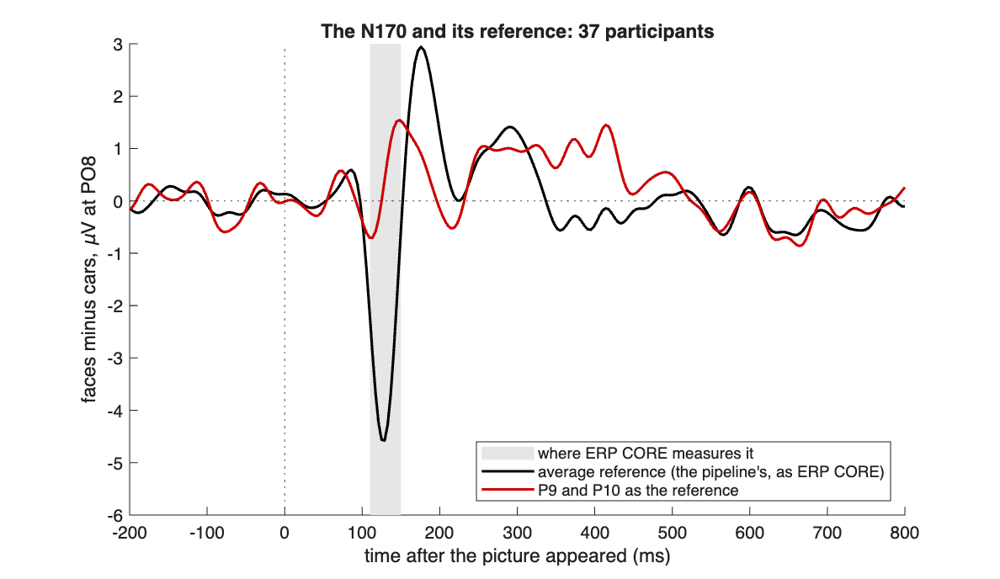

The black line is the difference between faces and cars at PO8 with the
average reference, over the 37 N170 participants ERP CORE kept: a clear
negative wave around 130 ms. The red line is the same data referenced to P9
and P10, and the N170 has almost vanished. Because the average reference is
built from every good channel, stage 4 matters most here: a broken channel
left in would be averaged into all the others.


---

## 8. Your homework

For each of your assigned participants, in order:

1. Run the pipeline and make your three decisions as you go, for example
   `out = cpsy1197_preprocess('data/12/12_N400.set');`.
2. The pipeline saves the cleaned data next to the raw file, for example
   `data/12/12_N400_clean.mat`. Keep it locally.
3. Run `cpsy1197_report(out, 'Your Name')` and copy the printed block into
   your preprocessing summary document.
4. Collect the summary files (for example `data/12/12_N400_summary.mat`);
   you upload them together.

One final run per participant. Expect the first to take the longest. Keep notes as you go: one or two sentences per
participant about anything unusual is the difference between a log you can
defend on 10 November and a pile of numbers.

If a run goes wrong halfway through, there is nothing to clean up. Fix the
problem and run that participant again from the top.

---

## 9. What to submit

Due 10 November on Canvas:

1. **The report blocks**, one per participant, pasted into a single document.
2. **The summary files**, one per participant.

A real report block, from the run in section 3:

```
--------------------------------------------------------------
CPSY 1197  preprocessing summary
--------------------------------------------------------------
Student          : Jane Student
File             : data/1/1_P3.set
Experiment       : P3b, active visual oddball
Run              : 2026-10-27 00:49:56

Recording
  channels       : 33
  sampling rate  : 256 Hz

Parameters given to you
  filter         : 0.1 to 30 Hz, firws
  resampled to   : 256 Hz  (from 1024)
  reference      : P9 + P10
  event shift    : +26 ms  (screen delay, ERP CORE)
  trials         : stimuli with a correct answer within 0.2 to 1 s
  epoch          : -0.2 to 0.8 s
  baseline       : -0.2 to 0 s

Decisions you made
  bad channels   : F8  (removed, rebuilt after referencing)
  ICA components : removed 1
  bad trials     : 4 marked by hand
                   13 46 48 133

  stimuli        : 200
  trials in      : 195  (5 without a correct answer in time)
  trials kept    : 184
  trials removed : 11  (5.6%: 7 by the rule, 4 by hand)

All 11 removed trials, by their number in the epoched data
  by the rule, peak-to-peak over 125 uV (7)
    14 25 91 92 93 95 187
  by hand (4)
    13 46 48 133

What the ICA bought you (same rule, one run)
                     without ICA    with ICA
   removed by rule     16 ( 8%)        7 ( 4%)
   recovered                        9 trials

Trials per condition
  target         : 34
  standard       : 150

--------------------------------------------------------------
```

Read your own blocks before you paste them. A rejection rate of 40% is not a
typo you can ignore, and the report will tell you so.

---

## 10. Troubleshooting

Typical errors

**`FieldTrip is not on your MATLAB path. Run addpath with your FieldTrip
folder, then cpsy1197_check.`** The `addpath` line is needed once per MATLAB
session, every time you restart MATLAB. Run it, then `cpsy1197_check`.

**`PROBLEM: 12_P3.set has no matching .fdt file next to it.`** from
`cpsy1197_check`, or **`Cannot not find data file: 12_P3.fdt`** (FieldTrip's
wording, typo included) at stage 1. You copied the `.set` without its `.fdt`.
Both files, always, in the same folder.

**`This is ERP CORE's processed file, not the raw recording. Use the file
with the short name next to it, 12_P3.set.`** Each participant folder may
also contain a file with a long name ending in `_weighted.set`. That is ERP
CORE's own processed version, and the pipeline refuses it. Use the short
name, as the message says.

**`The file name says P3b, but the event codes in it are those of the N170
experiment. Check that you copied the right file.`** The name of the file
and what is inside it disagree, usually because a file was renamed or copied
into the wrong folder. Copy that participant's two files again, under their
original names.

**`Cannot tell which experiment this file is.`** The file name has none of
`P3`, `N170` or `N400` in it, and the codes inside do not settle it either.
Use ERP CORE's original file names, like `12_N170.set`.

**`NOTE: params.eventtype and params.eventvalue are not used any more.`** You
used a command from an earlier version of this tutorial. It does no harm:
the trials come from the experiment, as printed at the top of the run.

**`Not a channel in this recording: F88. The names are listed at the top of
the run.`** A typo at the stage 4 prompt. The prompt asks again; type the
name as it appears in the `EEG (30):` list at the top. Separate several names
with commas: `PO8, F7`.

**`Cannot find .../template/layout/easycapM1.mat`** (or `standard_1020.elc`).
Your FieldTrip copy lacks its `template` folder. This happens with a
half-finished unzip, a "lite" download, or when the `template` folder was
deleted to save space. Download the full FieldTrip archive again, unzip all
of it, point `addpath` at the new folder and run `cpsy1197_check`, which tests
for both files. If you have two FieldTrip copies, remove the old one from
the path first (`rmpath`).

**`Type component numbers between 1 and 29, for example 1 or 1, 4.`** The
stage 5 prompt wants numbers. It asks again.

**`REFERENCE CHANGES. P9 is one of the reference channels ...`** Not an
error, but not harmless either: in the P3b or the N400 you named P9 or P10,
so your reference is the other one alone. Re-read section 4; if you stand by
the call, say so in your log. If you named both, the run stops with **`Both reference channels (P9
and P10) are marked broken, which leaves no reference.`**

**I closed the trial window and my marks were ignored.** Closing the
`ft_rejectvisual` window with the mouse keeps every trial that the rule did
not remove. Your marks count only when you press **q** or its quit button.
Run the participant again if it matters; if you had written your marks down,
you can give them to the pipeline with `params.badTrials` (section 6).

**The arrow keys do nothing in the trial window.** The window has to be the
active one: click on its title bar, then press the keys. Do not click on a
trace; that hides the channel until you click it again.

**Warnings that are harmless.** All of these appeared in every test run:

- `[Warning: adding .../external/eeglab toolbox to your MATLAB path]`, and the
  same for `brewermap`, `matplotlib`, `cmocean` and `colorcet`: FieldTrip
  loading parts of itself the first time they are needed.
- `[Warning: the data has been resampled, not showing the events]` when a
  browser opens.
- `discarding inconsistent elec structure` at stage 7.
- `[Warning: could not send tracker information for "startup"]` when
  FieldTrip starts without an internet connection.
- `Name is nonexistent or not a directory` when MATLAB starts: an old folder
  on your MATLAB path that no longer exists. It has nothing to do with this
  pipeline.

**The ICA prints dozens of `step NN` lines and seems stuck.** It is not
stuck. runica takes 70 to 90 steps, a few seconds on a recent laptop.

**The component numbers in this tutorial do not match mine.** For
participant 1 with F8 removed they should: the pipeline fixes ICA's random
seed, so the same recording with the same bad channels gives the same
components, and we got identical results in three MATLAB releases (R2023b,
R2025b, R2026a) on a Mac. On a different kind of computer the numbering can
still differ. If you removed a different channel, the decomposition is a
different one, and the numbers change. Compare components by their maps and
time courses, never by their numbers alone.

**A figure window is blank or looks mangled.** Resize the window once;
MATLAB occasionally mis-draws the first frame. The data are fine.

If you hit something not on this list, post the complete error text on the
Canvas Questions thread. Somebody else has almost certainly hit the same
thing, and answering a classmate counts toward participation.

---

## Sources

- ERP CORE: Kappenman, Farrens, Zhang, Stewart and Luck (2021), NeuroImage;
  the tasks in its section 2.2, the references in section 2.4. Data and
  scripts at [osf.io/thsqg](https://osf.io/thsqg/), one folder per
  experiment (`P3`, `N170`, `N400`), with the same files in each: the event
  shift and the reference in Script 1 and the README; the trials and
  conditions in `BDF_P3.txt`, `BDF_N170.txt` and `BDF_N400.txt`; where each
  component is measured in Script 12; the interpolated channels in
  `Interpolate_Channels_*.xlsx`; the removed components in
  `ICA_Components_*.xlsx`; the peak-to-peak limits in
  `AR_Parameters_for_MW_CRAP_*.xlsx`; the excluded participants in
  `*_Subject_Summary.xlsx`; the codes in `*_Event_Code_Scheme.xlsx`.
- Luck, *Applied Event-Related Potential Data Analysis*, Appendix 3, the
  example processing pipeline (socialsci.libretexts.org).
- FieldTrip:
  [ERP preprocessing tutorial](https://www.fieldtriptoolbox.org/tutorial/sensor/preprocessing_erp/),
  [ICA artifact cleaning](https://www.fieldtriptoolbox.org/tutorial/preproc/ica_artifact_cleaning/),
  [visual artifact rejection](https://www.fieldtriptoolbox.org/tutorial/preproc/visual_artifact_rejection/),
  [introduction to artifacts](https://www.fieldtriptoolbox.org/tutorial/preproc/artifacts/),
  [cleaning resting-state EEG (Madrid 2019)](https://www.fieldtriptoolbox.org/workshop/madrid2019/tutorial_cleaning/),
  [re-referencing before or after ICA](https://www.fieldtriptoolbox.org/faq/preproc/artifact/ica_rereference/),
  and the help text of every function in the table in section 2, in the
  installed version 20260812.
- Perrin, Pernier, Bertrand and Echallier (1989), spherical splines for scalp
  potential mapping, Electroencephalography and Clinical Neurophysiology.
