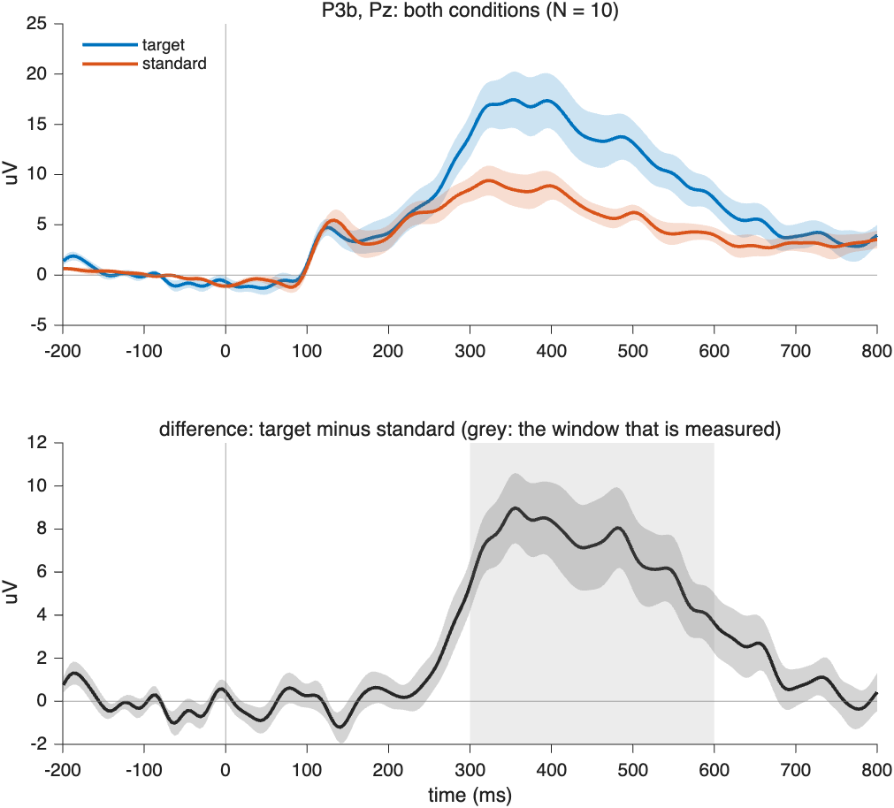
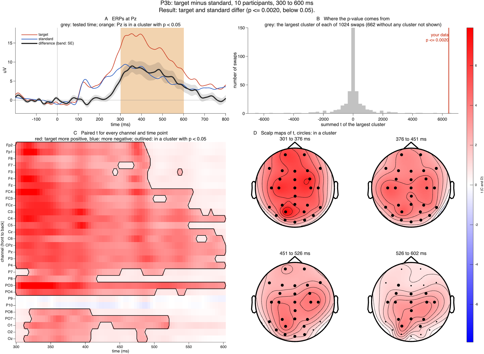

# Averaging tutorial, CPSY 1197

This is the second tutorial, for 10 November. The first one,
[TUTORIAL.md](TUTORIAL.md), took you from the raw recording to cleaned trials.
Here you learn how to average them: first the trials of each participant, then the
participants. You do not write any new code, and you make no new decisions.

What you need: the `*_clean.mat` file of every participant, which the
preprocessing saved next to the raw data (for example `data/12/12_N400_clean.mat`),
and FieldTrip on your path (`addpath('/path/to/fieldtrip-20260812')`, then
`cpsy1197_check` as before).

Averaging happens in two steps, and each step is its own script:

```
trials of one participant  ->  that participant's ERP, one per condition
                               (cpsy1197_average_within)
ERPs of all participants   ->  the grand average, per condition and for the difference
                               (cpsy1197_average_across)
```

Why two steps and not one big average over all trials? Because you want every
participant to count once. A participant who kept 190 trials would otherwise
weigh twice as much as one who kept 95, and the question of an ERP study is
what people in general do, not what the cleanest recording does. So the
trials are averaged within a person first, and the people are averaged
afterwards. The difference wave, for example target minus standard, is also
made within each person first, and then averaged across people.

---

## 1. Within participants

```matlab
cpsy1197_average_within('data')
```

It finds every `*_clean.mat` under `data/`, so run it once for all your
participants. To do just one, give it the file: `cpsy1197_average_within('data/12/12_N400_clean.mat')`.
For ten P3b participants it prints:

```
=== CPSY 1197 averaging within participants ===
10 participant file(s)
  2    P3b   target 38, standard 159            -> saved 2_P3_erp.mat
  3    P3b   target 30, standard 144            -> saved 3_P3_erp.mat
  ...
```

The numbers are the trials each condition has left after your three
decisions. Per condition, the script calls
[`ft_timelockanalysis`](https://www.fieldtriptoolbox.org/reference/ft_timelockanalysis/)
with `cfg.trials` listing the trials of that condition. That is the same call
the pipeline made for your summary file, and the script checks that its result
matches the average in the file. Then it makes the participant's difference
wave with [`ft_math`](https://www.fieldtriptoolbox.org/reference/ft_math/):

```matlab
cfg           = [];
cfg.parameter = 'avg';
cfg.operation = 'subtract';                % first condition minus second condition
diffwave      = ft_math(cfg, erp.cond.target, erp.cond.standard);
```

The difference waves of the three experiments, and where ERP CORE measures them:

| | P3b | N170 | N400 |
|---|---|---|---|
| Difference wave | target minus standard | faces minus cars | unrelated minus related |
| Channel | Pz | PO8 | CPz |
| Window | 300 to 600 ms | 110 to 150 ms | 300 to 500 ms |

Each participant gets a file next to the clean one, for example
`data/2/2_P3_erp.mat`. It holds the variable `erp`: the averages per condition
(`erp.cond`), the difference wave (`erp.diff`), and the number of trials
(`erp.nTrials`). Besides the average, `ft_timelockanalysis` stores the
variance over trials (`var`) and the number of trials (`dof`).

---

## 2. Across participants

```matlab
ga = cpsy1197_average_across('data');
```

```
=== CPSY 1197 averaging across participants: P3b ===
  10 participants averaged: [2 3 4 5 7 8 11 12 13 14]

Mean amplitude at Pz, 300 to 600 ms (uV), mean and standard error over 10 participants:
  target         13.72  (SE 2.24)
  standard        6.72  (SE 0.97)
  difference      6.99  (SE 1.49)

Participants far from the others (more than 2.5 SD from the mean amplitude in the window):
  target                             2
  difference: target minus standard  2

Saved data/grandavg_P3b.mat and four figures next to it.
```

(FieldTrip adds a line "computing average of avg across 10 subjects" per
condition.) The averaging is
[`ft_timelockgrandaverage`](https://www.fieldtriptoolbox.org/reference/ft_timelockgrandaverage/),
one call per condition and one for the difference wave, with one input per
participant:

```matlab
cfg           = [];
cfg.method    = 'across';          % the default: every participant counts once
cfg.parameter = 'avg';
grandTarget   = ft_timelockgrandaverage(cfg, erp1.cond.target, erp2.cond.target, ...);
```

The result has `avg`, the mean over participants, and `var` and `dof`, the
variance of the participants' ERPs around that mean and the number of
participants. The standard error is `sqrt(var ./ dof)`. (`method = 'within'`
exists, too, but it is for blocks of one participant, not for what we do here;
that is why our "within" script uses `ft_timelockanalysis`.)

**Who goes in.** One experiment only: the script refuses to average across
experiments, they have different tasks, references and conditions. A
participant with fewer than 10 trials in either of the two conditions is left
out, and the printout names the participant and says why. A participant who
appears twice (the same number in two folders) is counted once. Nobody is left
out for any other reason; noisy participants stay in, and you say in your
write-up if you think one should not.

**Options.** All optional, in a `params` structure like in the pipeline:

```matlab
ga = cpsy1197_average_across('data', struct('negativeUp', true, 'minTrials', 20));
```

| Option | Meaning | Default |
|---|---|---|
| `experiment` | `'P3b'`, `'N170'` or `'N400'`; if your `data` folder holds more than one and you give none, you are asked | |
| `minTrials` | fewest trials per condition a participant needs | 10 |
| `negativeUp` | `true` draws negative voltages upward, as many ERP papers do | `false` |
| `channel`, `window` | channel and time window (in seconds) of the figures and amplitudes | ERP CORE's, see above |
| `save` | `false` writes no files | `true` |

**The four figures.**



1. *The channel of the component.* Top: both conditions. Bottom: the
   difference wave. The shaded band around every curve is one standard
   error across participants (the standard deviation of the participants'
   values divided by $\sqrt{N}$): where the band is narrow, the participants
   agree. The grey area is the window that is measured. FieldTrip's own
   plotting function, `ft_singleplotER`, does not draw error bands, so this
   figure is drawn by hand.
2. *All channels on the head* with
   [`ft_multiplotER`](https://www.fieldtriptoolbox.org/reference/ft_multiplotER/).
   Click and drag a rectangle around some channels, then click it, to see
   their average larger.
3. *The scalp topography* in the measured window, for both conditions on one
   colour scale and for the difference on its own scale, with
   [`ft_topoplotER`](https://www.fieldtriptoolbox.org/reference/ft_topoplotER/).
   FieldTrip draws positive in warm colours; the scale is in µV.
4. *Every participant on top of the average.* One panel for each condition
   and one for the difference wave, at the same channel: a thin grey line per
   participant, the average thick. A mean can hide that it rests on a few
   people, and this is where you see it. If the thin lines mostly run with the
   thick one, the effect is shared. A participant whose mean amplitude in the
   window lies more than 2.5 standard deviations from the mean of all
   participants is drawn in red with their number, and listed in the printout.
   That is a reason to look at that person's data again, not to drop them: you
   say what you see in your write-up.

The mean amplitude is one number per participant, the average of the ERP over
the window at the channel, so the standard error in the printout is over
people and not over time points.

**What you get.** The grand average shows whether the effect is there and how
consistent it is. It is not a test: there is no p-value here. With ten
participants, treat the band and the amplitude as a description. The test
comes in the next section.

---

## 3. Testing the difference: a cluster-based permutation test

```matlab
stat = cpsy1197_cluster_test('data');
```

It reads the `grandavg_<experiment>.mat` that `cpsy1197_average_across` saved,
so run that first. It asks one question: do the two conditions differ?

**First time? Take the guided tour.**

```matlab
cpsy1197_cluster_tutorial('data')
```

This runs the same test step by step on your own grand average and stops
after every step. It shows you a figure, explains it, and waits for Enter.
Three times it asks you to type an answer: how many false alarms you expect,
what share of the swaps beats your data, and which sentence belongs in your
report. Nothing is graded. The eight steps:

1. your data: both conditions and their difference;
2. one t-test per channel and time point, and how many "significant" points
   chance alone gives you;
3. clusters: which channels are neighbours, and your clusters;
4. three random swaps of the conditions, one at a time;
5. all the swaps together, and where the p-value comes from;
6. what you may and may not write in your report;
7. what changes with the threshold and with the number of participants;
8. the same test in FieldTrip (`cpsy1197_cluster_test`), and whether both
   give the same p.

Steps 2 to 5 are written out in plain MATLAB in the tutorial script, so you
can read how each step is done. It takes about 15 minutes. It accepts the
same `experiment`, `analysis` and `subjects` options as the test below. With
`struct('figures', 'tour')` it also saves each step's figure as a `.png` in a
folder `tour`. The tour is for understanding. For your report, use
`cpsy1197_cluster_test`.

**Why not a t-test per channel and time point?** An ERP has 30 channels and
about 250 time points, 7500 numbers. Test each of them at p < 0.05 and you
expect hundreds of "significant" points by chance alone. The cluster test
([Maris and Oostenveld 2007](https://doi.org/10.1016/j.jneumeth.2007.03.024))
makes one test out of all of them:

1. For every channel and time point, a paired t-test compares the two
   conditions across participants (paired, because every participant saw
   both).
2. Points with p < 0.05 are kept. Kept points that touch, in time or on
   neighbouring channels, form a cluster. The t-values in a cluster are
   summed: that sum is the cluster's strength.
3. If the conditions did not differ, it would not matter which of a
   participant's two ERPs is called "target" and which "standard". So the
   script swaps the two labels at random within participants, repeats steps
   1 and 2, and notes the strongest cluster. Many swaps give the strengths
   you would expect by chance.
4. The p-value is the share of swaps whose strongest cluster is at least as
   strong as the one in your data.

With ten participants there are only $2^{10} = 1024$ ways to swap, and the
script tries all of them, so the p-value is exact. With more participants it
takes 5000 random swaps. The smallest possible p is then about 2 divided by
the number of swaps, which is why the printout can say `p <= 0.0020`.

**What the result says, and what it does not.** A p below 0.05 means: the two
conditions differ. It does not say when the effect starts or ends, or on
which channels it is. The edges of a cluster depend on the threshold of step
2, on the noise and on the channels, so in your write-up say "target and
standard differed (cluster-based permutation test, p = ...)", and describe
the time and channels of the cluster as where the difference was strongest,
not as "a significant effect from 280 to 610 ms". See the
[FieldTrip FAQ](https://www.fieldtriptoolbox.org/faq/how_not_to_interpret_results_from_a_cluster-based_permutation_test/)
on this point.

**Two analyses.**

```matlab
stat = cpsy1197_cluster_test('data');                               % the window of the component
stat = cpsy1197_cluster_test('data', struct('analysis', 'full'));   % 0 to 800 ms
```

The default tests all channels, but only in the window of the component
(the table in section 1). ERP CORE chose that window before seeing your data,
so this is the test of the question you came with, and it is the more
sensitive one. `'full'` tests everything from 0 to 800 ms. It is exploratory:
it can find a difference you did not expect, but it has to beat chance over a
much larger space. Report which one you ran.

For ten P3b participants it prints (FieldTrip's own messages are hidden):

```
=== CPSY 1197 cluster-based permutation test: P3b ===
  target minus standard, 10 participants: [2 3 4 5 7 8 11 12 13 14]
  all 30 channels, 300 to 600 ms (the window of the component, chosen in advance)
  every possible swap of the two conditions (1024), so the p-value is exact
  a point joins a cluster if its own p < 0.05 and at least 2 neighbouring channels pass too
  running, this can take a minute ...

  Clusters with target more positive than standard:
    p <= 0.0020   summed t   6430.5   301 to 602 ms   PO3 Pz CPz C4 P4 P3 Cz C6 and 20 more
  Clusters with target more negative than standard:
    none

  Result: target and standard differ (p <= 0.0020, below 0.05).
  Read it as: the conditions differ, or not. The times and channels of a cluster show where the
  difference was strongest in these data. They are not the start, end or location of the effect.
```

The test is two-sided: a cluster can go either way, and both directions are
listed. The p-values are already corrected for that, so compare them with
0.05. Only the strongest cluster per direction and any others below 0.05 are
printed. For the N170 you will usually see two clusters at the same time, a
negative one at the back of the head and a positive one at the front. That is
one effect seen from two sides: the data are referenced to the average of all
channels, so a negative difference in one place comes with a positive one
elsewhere.

**How it is done in FieldTrip.** The script calls
[`ft_timelockstatistics`](https://www.fieldtriptoolbox.org/reference/ft_timelockstatistics)
with every participant's ERP of each condition, as in FieldTrip's
[tutorial on cluster tests for ERPs](https://www.fieldtriptoolbox.org/tutorial/stats/cluster_permutation_timelock/):

```matlab
cfg                  = [];
cfg.latency          = [0.3 0.6];          % the window of the component
cfg.method           = 'montecarlo';       % p-value from swapping the labels
cfg.statistic        = 'ft_statfun_depsamplesT';   % paired t-test
cfg.correctm         = 'cluster';
cfg.clusteralpha     = 0.05;               % threshold for a point to join a cluster
cfg.clusterstatistic = 'maxsum';           % strength of a cluster: the sum of its t-values
cfg.minnbchan        = 2;                  % a point needs 2 neighbouring channels that pass, too
cfg.neighbours       = neighbours;         % which channels are neighbours
cfg.tail             = 0;                  % two-sided
cfg.clustertail      = 0;
cfg.alpha            = 0.05;
cfg.correcttail      = 'prob';             % p-values doubled for the two sides
cfg.numrandomization = 'all';              % every possible swap (or 5000)
cfg.design           = [1:N 1:N; ones(1,N) 2*ones(1,N)];  % row 1: participant, row 2: condition
cfg.uvar             = 1;
cfg.ivar             = 2;
stat = ft_timelockstatistics(cfg, targets, standards);
```

The neighbours come from
[`ft_prepare_neighbours`](https://www.fieldtriptoolbox.org/reference/ft_prepare_neighbours)
with `cfg.method = 'triangulation'` on the electrode layout, which links each
of the 30 channels to its 4 to 8 nearest ones.

**The figure.** One figure with four panels, here for the ten P3b
participants above:



- **A. The ERPs at the component's channel**: both conditions and their
  difference with its standard error. Grey: the tested time. Orange: where
  this channel is part of a cluster with p < 0.05. That is a description,
  not the onset of the effect.
- **B. Where the p-value comes from**: for every swap of step 3, the summed
  t of its strongest cluster (grey), and the strongest cluster of your data
  (coloured line). The p-value is the share of swaps that reach your line,
  doubled for the two sides. If your line is far outside the grey, the
  difference is very unlikely to be chance.
- **C. The t-values for every channel and time point**, channels from the
  front of the head (top) to the back. Red: the first condition is more
  positive, blue: more negative. Points in a cluster with p < 0.05 are
  outlined in black, the rest is faded.
- **D. Scalp maps of the t-values** in four steps across the tested time,
  on the same colour scale as C. Black circles: channels that belong to a
  cluster with p < 0.05 somewhere in that step.

The colour scale of C and D ends at the 99th percentile of the t-values, so a
few extreme values (with few participants t can get very large) do not wash
out the rest.

The script saves `clusterstat_<experiment>_window.mat` (or `_full`) with the
variables `stat` and `settings`, and the figure as `.png` next to it.

**How many participants?** It runs with any number from 2 on, for every
experiment. But with $N$ participants there are only $2^N$ ways to swap, so the
smallest possible p is $2/2^N$: 0.0625 for five participants, 0.03125 for six.
With fewer than six the test cannot get below 0.05, whatever the data. The
script still runs and draws the figure, but says
`Result: cannot be decided with 5 participants`.

**Options.** All optional, in a `params` structure:

| Option | Meaning | Default |
|---|---|---|
| `experiment` | `'P3b'`, `'N170'` or `'N400'`; if your `data` folder holds more than one and you give none, you are asked | |
| `analysis` | `'window'` or `'full'`, see above | `'window'` |
| `latency` | your own time window in seconds, for example `[0.2 0.4]`, instead of the analysis | |
| `subjects` | participant numbers to use, a subset of those in the grand average | all |
| `numrandomization` | number of random swaps | all swaps if there are at most 5000, else 5000 |
| `clusteralpha`, `alpha`, `minnbchan` | the thresholds in the code above | 0.05, 0.05, 2 |
| `seed` | start of the random numbers; the same seed gives the same p | 42 |
| `negativeUp` | `true` draws negative voltages upward in panel A | `false` |
| `save` | `false` writes no files | `true` |
| `show` | `false` does not show the figure on screen (it is still saved) | `true` |

Change the thresholds only if you have a reason you can write down before you
look at the result. Trying several and reporting the one that "works" makes
the p-value meaningless.

---

## 4. If something breaks

**`FieldTrip is not on your MATLAB path. Run addpath with your FieldTrip
folder, then cpsy1197_check.`** The `addpath` line is needed once per MATLAB
session, every time you restart MATLAB. Run
`addpath('/path/to/fieldtrip-20260812')`, then `cpsy1197_check`, then the
averaging again.

**`No *_clean.mat files in "data". Run cpsy1197_preprocess first.`** The
scripts look for the cleaned data under the folder you give them. Check that
you are in the right folder (`pwd`) and that the files exist.

**`The folder holds more than one experiment`.** The script lists them and asks
which one to average; type its number. To skip the question, pass the one you
want: `cpsy1197_average_across('data', struct('experiment', 'N170'))`.

**`Need at least 2 participants for a grand average`.** After the left-out
participants were removed, fewer than two were left. Read the lines above the
error: they say who was left out and why.

**`this average differs from the one in the file`.** The cleaned data and the
averages inside the same `_clean.mat` do not agree, which should not happen.
Run that participant through `cpsy1197_preprocess` again.

**`No grandavg_*.mat in "data". Run cpsy1197_average_across first.`** The
cluster test works on the grand average, not on the single participants. Run
`cpsy1197_average_across('data')` first.

**`NOTE: with these 32 swaps the smallest possible p is 0.0625`.** You have
fewer than six participants (here five). The test runs, but cannot get below
0.05, whatever the data, so the result says `cannot be decided`. Use more
participants.

**The p-value changes when I run it again.** Only if you have more than 12
participants and changed the `seed`: then the swaps are drawn at random. With
the same seed you get the same p. A change in the third decimal is the
randomness of the swaps, not of your data.
