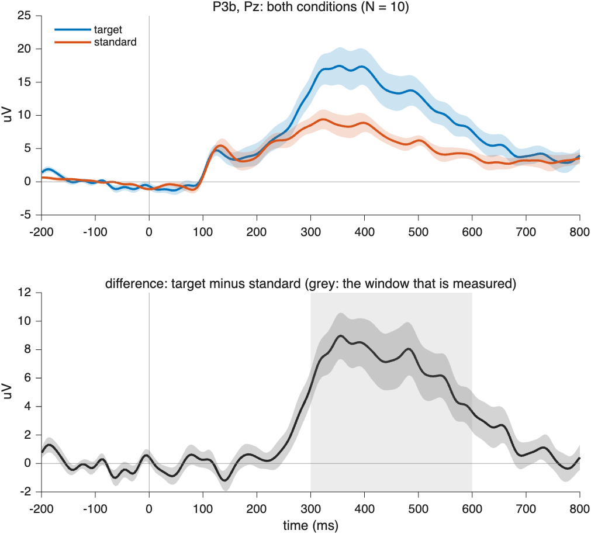

# Averaging tutorial, CPSY 1197

This is the second tutorial, for 10 November. The first one,
[TUTORIAL.md](TUTORIAL.md), took you from the raw recording to cleaned trials.
Here you average them: first the trials of each participant, then the
participants. You do not write any new code, and you make no new decisions.

What you need: the `*_clean.mat` file of every participant, which the
preprocessing saved next to the raw data (for example `data/12/12_N400_clean.mat`),
and FieldTrip on your path (`addpath('/path/to/fieldtrip-20260812')`, then
`cpsy1197_check` as before).

Averaging happens in two steps, and each step is its own script:

```
trials of one participant  ->  that participant's ERP, one per condition
                               (cpsy1197_average_within)
ERPs of all participants   ->  the grand average, per condition and for the difference
                               (cpsy1197_average_across)
```

Why two steps and not one big average over all trials? Because you want every
participant to count once. A participant who kept 190 trials would otherwise
weigh twice as much as one who kept 95, and the question of an ERP study is
what people in general do, not what the cleanest recording does. So the
trials are averaged within a person first, and the people are averaged
afterwards. The difference wave, for example target minus standard, is also
made within each person first, and then averaged across people.

---

## 1. Within participants

```matlab
cpsy1197_average_within('data')
```

It finds every `*_clean.mat` under `data/`, so run it once for all your
participants. To do just one, give it the file: `cpsy1197_average_within('data/12/12_N400_clean.mat')`.
For ten P3b participants it prints:

```
=== CPSY 1197 averaging within participants ===
10 participant file(s)
  2    P3b   target 38, standard 159            -> saved 2_P3_erp.mat
  3    P3b   target 30, standard 144            -> saved 3_P3_erp.mat
  ...
```

The numbers are the trials each condition has left after your three
decisions. Per condition, the script calls
[`ft_timelockanalysis`](https://www.fieldtriptoolbox.org/reference/ft_timelockanalysis/)
with `cfg.trials` listing the trials of that condition. That is the same call
the pipeline made for your summary file, and the script checks that its result
matches the average in the file. Then it makes the participant's difference
wave with [`ft_math`](https://www.fieldtriptoolbox.org/reference/ft_math/):

```matlab
cfg           = [];
cfg.parameter = 'avg';
cfg.operation = 'subtract';                % first condition minus second condition
diffwave      = ft_math(cfg, erp.cond.target, erp.cond.standard);
```

The difference waves of the three experiments, and where ERP CORE measures them:

| | P3b | N170 | N400 |
|---|---|---|---|
| Difference wave | target minus standard | faces minus cars | unrelated minus related |
| Channel | Pz | PO8 | CPz |
| Window | 300 to 600 ms | 110 to 150 ms | 300 to 500 ms |

Each participant gets a file next to the clean one, for example
`data/2/2_P3_erp.mat`. It holds the variable `erp`: the averages per condition
(`erp.cond`), the difference wave (`erp.diff`), and the number of trials
(`erp.nTrials`). Besides the average, `ft_timelockanalysis` stores the
variance over trials (`var`) and the number of trials (`dof`).

---

## 2. Across participants

```matlab
ga = cpsy1197_average_across('data');
```

```
=== CPSY 1197 averaging across participants: P3b ===
  10 participants averaged: [2 3 4 5 7 8 11 12 13 14]

Mean amplitude at Pz, 300 to 600 ms (uV), mean and standard error over 10 participants:
  target         13.72  (SE 2.24)
  standard        6.72  (SE 0.97)
  difference      6.99  (SE 1.49)
Saved data/grandavg_P3b.mat and three figures next to it.
```

(FieldTrip adds a line "computing average of avg across 10 subjects" per
condition.) The averaging is
[`ft_timelockgrandaverage`](https://www.fieldtriptoolbox.org/reference/ft_timelockgrandaverage/),
one call per condition and one for the difference wave, with one input per
participant:

```matlab
cfg           = [];
cfg.method    = 'across';          % the default: every participant counts once
cfg.parameter = 'avg';
grandTarget   = ft_timelockgrandaverage(cfg, erp1.cond.target, erp2.cond.target, ...);
```

The result has `avg`, the mean over participants, and `var` and `dof`, the
variance of the participants' ERPs around that mean and the number of
participants. The standard error is `sqrt(var ./ dof)`. (`method = 'within'`
exists, too, but it is for blocks of one participant, not for what we do here;
that is why our "within" script uses `ft_timelockanalysis`.)

**Who goes in.** One experiment only: the script refuses to average across
experiments, they have different tasks, references and conditions. A
participant with fewer than 10 trials in either of the two conditions is left
out, and the printout names the participant and says why. A participant who
appears twice (the same number in two folders) is counted once. Nobody is left
out for any other reason; noisy participants stay in, and you say in your
write-up if you think one should not.

**Options.** All optional, in a `params` structure like in the pipeline:

```matlab
ga = cpsy1197_average_across('data', struct('negativeUp', true, 'minTrials', 20));
```

| Option | Meaning | Default |
|---|---|---|
| `experiment` | `'P3b'`, `'N170'` or `'N400'`; needed only if your `data` folder holds more than one | |
| `minTrials` | fewest trials per condition a participant needs | 10 |
| `negativeUp` | `true` draws negative voltages upward, as many ERP papers do | `false` |
| `channel`, `window` | channel and time window (in seconds) of the figures and amplitudes | ERP CORE's, see above |
| `save` | `false` writes no files | `true` |

**The three figures.**



1. *The channel of the component.* Top: both conditions. Bottom: the
   difference wave. The shaded band around every curve is one standard
   error across participants (the standard deviation of the participants'
   values divided by $\sqrt{N}$): where the band is narrow, the participants
   agree. The grey area is the window that is measured. FieldTrip's own
   plotting function, `ft_singleplotER`, does not draw error bands, so this
   figure is drawn by hand.
2. *All channels on the head* with
   [`ft_multiplotER`](https://www.fieldtriptoolbox.org/reference/ft_multiplotER/).
   Click and drag a rectangle around some channels, then click it, to see
   their average larger.
3. *The scalp topography* in the measured window, for both conditions on one
   colour scale and for the difference on its own scale, with
   [`ft_topoplotER`](https://www.fieldtriptoolbox.org/reference/ft_topoplotER/).
   FieldTrip draws positive in warm colours; the scale is in µV.

The mean amplitude is one number per participant, the average of the ERP over
the window at the channel, so the standard error in the printout is over
people and not over time points.

**What you get, and what this tutorial does not do.** The grand average shows
whether the effect is there and how consistent it is. It is not a test: there
is no p-value here. With ten participants, treat the band and the amplitude
as a description.

---

## 3. If something breaks

**`No *_clean.mat files in "data". Run cpsy1197_preprocess first.`** The
scripts look for the cleaned data under the folder you give them. Check that
you are in the right folder (`pwd`) and that the files exist.

**`The folder holds more than one experiment (N170, P3b). Never average across
experiments.`** Pass the one you want:
`cpsy1197_average_across('data', struct('experiment', 'N170'))`.

**`Need at least 2 participants for a grand average`.** After the left-out
participants were removed, fewer than two were left. Read the lines above the
error: they say who was left out and why.

**`this average differs from the one in the file`.** The cleaned data and the
averages inside the same `_clean.mat` do not agree, which should not happen.
Run that participant through `cpsy1197_preprocess` again.
